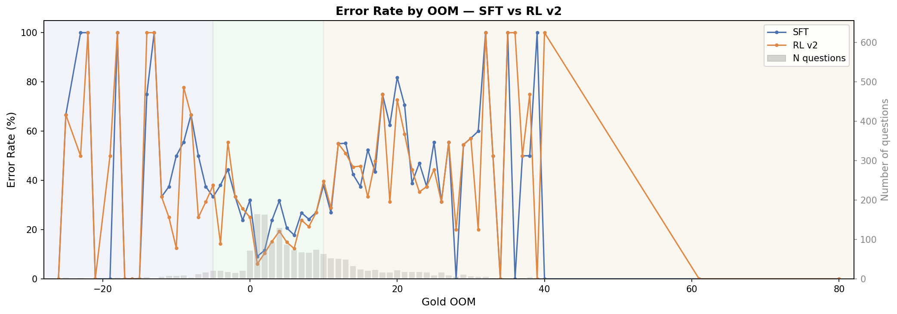

# WeFiguredItOut: Fermi Estimation Fine-Tuning

**DS595 — Spring 2026**  
Achuthan Rathinam · Ria Sonalker · George Jr. Escobar · Puchen Liu

---

## Capability

A **Fermi estimation** is a back-of-the-envelope calculation to estimate the *order of magnitude* of a quantity that seems impossible to know at first glance — named after Enrico Fermi, who famously estimated the number of piano tuners in Chicago from first principles.

Fermi problems are a natural test bed for language model reasoning because they require **multi-step decomposition**: a model must identify relevant physical constants or real-world anchors, chain them together in a formula, carry out the arithmetic, and land within roughly the right order of magnitude. Getting any one step wrong can compound into an answer that is off by many decades.

Frontier LLMs struggle with this task for three reasons:

1. **No physical intuition** — models learn from token statistics and do not have an embodied sense of magnitudes. They may recall that a human weighs ~70 kg while simultaneously treating a galaxy as a similar-sized object.
2. **Error compounding** — a Fermi problem typically involves five or more multiplicative factors. A 2× error in each of five factors produces a 32× (≈1.5 OOM) final error.
3. **Calibration mismatch** — instruction-tuned models are trained to appear confident and precise. They tend to give definite-sounding answers even when their underlying uncertainty is high, with no mechanism for recognizing when 10³⁰ is unreasonably large.

These properties make Fermi estimation a genuinely challenging capability gap: the failure mode is not factual recall but quantitative physical reasoning.

---

## Evaluation

### Dataset

The master dataset contains **5,008 Fermi estimation questions** integrated from four sources:

| Source | Type | Total (post-dedup) |
|--------|------|--------------------|
| Science Olympiad (`scioly`) | Competition questions | 3,593 |
| FermiP real (`realFP`) | Real-world estimates | 725 |
| FermiQ (`fermiq`) | Physics/science questions | 229 |
| Student traces | Model-generated reasoning | — |
| ~~SynthFP~~ | ~~Synthetic questions~~ | ~~removed~~ |

Raw sources were parsed, OOM-clipped to the range [−30, 40], deduplicated (14,427 unique after 384 removed), and split into three non-overlapping sets:

| Split | Size | Purpose |
|-------|------|---------|
| Train | ~2,815 | SFT + RL training |
| Val | 1,693 | Monitoring only (never used in training decisions) |
| Eval | 500 → **320 (SynthFP-free)** | Held-out final reporting |

**Why 320, not 500?** The paper introducing the FermiQ dataset flagged SynthFP questions as having systematically unreliable ground truths — answers were generated programmatically and in some cases are wrong. We removed 180 SynthFP questions from the eval set, leaving 320 questions with human-curated or competition-sourced answers. Evaluation on the SynthFP-free set gives a cleaner and more honest signal of fine-tuning gains (the base model likely memorized SynthFP patterns during pretraining, inflating its baseline).

### Input/Output Format — Prompt Contract

The model is required to output a single JSON object with no prose before or after:

```json
{
  "restatement": "one sentence in your own words",
  "assumptions": ["..."],
  "factors": [
    {
      "name": "label", "symbol": "var", "low": <number>,
      "high": <number>, "point": <number>, "unit": "...", "why": "..."
    }
  ],
  "formula": "N_people * liters_per_day * 365",
  "calculation": "one-line arithmetic using point values",
  "final": { "value": <number>, "unit": "...", "oom": <integer> },
  "confidence": "low | medium | high"
}
```

The `factors` array forces explicit decomposition; `formula` + `calculation` make the reasoning auditable; `final.oom` (= floor(log₁₀(answer))) is what we score against. Parse failures — responses that are not valid JSON or missing required fields — receive a hard penalty.

### Scoring

**FP Score** (used for all eval reporting):

```
score = max(0, 1 − δ / 3.0)    where δ = |log₁₀(pred) − gold_oom|
```

A score of 1.0 means exact OOM match; the score decays linearly to 0 at ±3 decades of error.

**RL OOM Score** (used during GRPO training only):

```
score = max(0, 1 − δ / 1.5)
```

Stricter tolerance (±1.5 decades to zero) concentrates the training gradient on answers that are within an order of magnitude.

### Eval Script

The eval script is at `src/sampling/evaluate_sampling.py`. To reproduce the held-out results:

```bash
python src/sampling/evaluate_sampling.py \
    --input datasets/final/eval_no_synthfp.json \
    --fp-score \
    --output run/eval_results.json
```

---

## Training

### Data

The SFT training set was built through a four-stage pipeline:

**Stage 1 — Verification.** We used `Qwen3-30B-A3B-Instruct-2507` (a larger, stronger model) to verify whether each training question had a correct ground-truth label. The verifier ran in two passes per question: first generating a search plan (what facts are needed), then computing a structured answer using a static fact lookup file (`datasets/fermi_facts.json`, ~500 pre-fetched Fermi-relevant constants). We intentionally moved away from live Tavily web search after finding it expensive, rate-limited, and slow at scale; the static lookup gives zero-cost, reproducible evidence retrieval.

Each question received a `consensus_verdict`:

| Split | Correct | Incorrect | Uncertain | Total |
|-------|---------|-----------|-----------|-------|
| Train | 975 | 1,783 | 60 | 2,818 |
| Val | 627 | 1,120 | 58 | 1,693 |

**Stage 2 — Filtering and relabeling.** `correct` verdicts were kept as-is. `uncertain` verdicts were dropped. `incorrect` verdicts with OOM error ≤ 2 and high/medium verifier confidence were **relabeled** (the ground truth was updated to the verifier's prediction) — this recovers borderline cases where the original dataset label, not the model, was wrong. This produced a filtered training set of **1,951 records** (train) and **1,169 records** (val).

**Stage 3 — Trace preparation.** Filtered records were converted to the SFT messages format: a three-turn conversation (system → user question → assistant JSON answer) expected by Tinker. Output: ~2,920 train examples, 200 val examples.

### Model and Method

**Base model:** `Qwen/Qwen3-4B-Instruct-2507`

**Stage 1 — Supervised Fine-Tuning (SFT).** LoRA (rank 32) fine-tuning to teach the model the structured JSON output format and imitate verified reasoning traces.

- First run (`sft_filtered_v1`): 2 epochs, batch size 2048 — only 2 gradient steps total; insufficient.
- **Final run (`sft_filtered_v1_v2`):** 3 epochs, batch size 32 — **273 gradient steps**, loss 1.08 → 0.13 (88% reduction).
- Config: LR = 4.91e-4, max length = 2048 tokens, linear schedule.
- Estimated cost: **$2.31**

Val score trajectory: **0.518 → 0.617 → 0.691** across checkpoints — confirming generalization, not memorization.

**Stage 2 — GRPO (Group Relative Policy Optimization / RL).** Applied GRPO on top of the SFT checkpoint to push accuracy beyond what imitation learning can achieve.

Reward function (RL v2, the final run):

```
reward = 0.85 × oom_score + 0.15 × struct_score

oom_score    = max(0, 1 − δ / 1.5)
struct_score = (has_factors + has_calc + has_formula) / 3

Tail OOM multiplier: oom_score × 1.3 if gold_oom ≤ −4 or ≥ 10
Parse fail  → reward = −1.0
Schema fail → reward = −0.5
```

The 0.85/0.15 split (accuracy/structure) reflects that after SFT the structural output is near-perfect (~75% parse OK at RL start → 97% at end), so the gradient is concentrated where improvement is still possible — accuracy.

Three RL runs were conducted:

| Run | Steps | Start Reward | Final Reward | Notes |
|-----|------:|-------------:|-------------:|-------|
| RL v1 | 139 | 0.462 | 0.663 | Lenient scoring (δ/3.0), weights 0.70/0.30 |
| **RL v2** | **250** | **0.216** | **0.567** ✓ | Stricter scoring (δ/1.5), lower KL |
| RL v3 | 78 💥 | 0.282 | 0.361 | v2 + tail OOM oversampling without group_size increase |

RL v2: we noticed that the model was underperfoming and had a high failure rate with tail OOM questions

[INSERT PLOT HERE]

RL v3 crashed: tried oversampling tail OOM questions (50% vs natural 40%), howevere the run crashed due to internet connection issues.

**No non-training methods** (tools, retrieval, or prompting hacks) are used at inference time — the final model produces answers from its weights alone.

---

## Results

### Frontier Model Baselines

Evaluated on 5 hand-crafted Fermi questions spanning microbiology, atmospheric chemistry, thermodynamics, and acoustics:

| Model | Raw Avg | Corrected Avg | Notes |
|-------|--------:|-------------:|-------|
| Claude Opus 4.6 | 0.884 | **0.884** | No extraction issues |
| Gemini 2.5 Flash | 0.704 | ~0.74 | Q1 LaTeX mantissa extracted incorrectly |
| GPT-5.4 | 0.380 | ~**0.68** | Q2 + Q5 LaTeX notation broke regex extractor |

Extraction artifact: three frontier model answers used LaTeX math notation (`\(3\times 10^6\)`) which the regex extractor grabbed as just the mantissa. Corrected GPT-5.4 score: ~0.68 (not 0.38).

**Key frontier failure modes:**
- **Q1 (gut bacteria energy in lightning bolts):** GPT-5.4 conflated bacterial mass (10⁻¹² g) with energy (10⁻¹² J), off by 1000×. Gemini used biomass energy density instead of ATP cost, off by ~20×. Only Claude used the correct ATP hydrolysis approach.
- **Q3 (CO₂ above tennis courts):** Models estimated global tennis court count in a 30× range (165,000 to 5,000,000 vs ~800,000 actual). Physical reasoning (CO₂ column density) was correct; the anchor estimate was not.
- **Q4 (wind turbine KE → lake temperature):** All three models got this right — multi-step rotational physics was within reach.

### Three-Way Comparison — SynthFP-Free Eval (n=320)

Baseline = Qwen3-4B-Instruct-2507 with no fine-tuning.  
Finetuned = SFT checkpoint → RL v2 checkpoint.

| Metric | Frontier (Claude) | Baseline (Qwen3-4B) | Finetuned | Δ (base → fine) |
|--------|------------------:|--------------------:|----------:|:----------------|
| Mean score | 0.884 | 0.516 | **0.574** | **+0.058** |
| Exact OOM | — | 32.5% | **39.4%** | **+6.9%** |
| Within 1 decade | — | 55.9% | **63.8%** | **+7.9%** |
| Within 2 decades | — | 68.8% | **74.4%** | **+5.6%** |
| Parse OK | — | 95.3% | **99.4%** | **+4.1%** |
| Score = 0 (fail) | — | 25.0% | **22.5%** | **−2.5%** |

### Performance by OOM Range

The model performs best on everyday-scale questions (OOM −3 to 9), which make up the bulk of the training data:

| OOM Range | RL v2 Score | Notes |
|-----------|------------:|-------|
| Mid-Low (−3 to 2) | 0.633 | Best performance |
| Mid-High (3 to 9) | 0.586 | Strong |
| High (10 to 19) | 0.401 | Degraded |
| Very High (≥20) | 0.374 | **48.5% zero-score rate** |
| Low (−9 to −4) | 0.449 | Degraded |
| Very Low (≤−10) | 0.470 | Limited data |

We noticed that RL v2 was underperforming and had a high failure rate on tail OOM questions. The grey histogram below shows why: the training set is heavily concentrated in the everyday OOM range (−3 to 9), leaving extreme OOMs severely underrepresented. Both SFT and RL v2 show near-identical error rates at the tails, confirming that RL did not help there.



The performance cliff at extreme OOMs is caused by the **zero-gradient problem in GRPO**: when all rollouts in a batch score 0 (as commonly happens on Very High OOM questions), there is no learning signal and the policy does not improve.

### Failure Modes and Regressions

- **Tail OOM accuracy remains poor.** High zero-score rates at extreme OOMs (≤−10, ≥20) persist through both SFT and RL.
- **Confidence is uncalibrated.** High-confidence answers are wrong ~26% of the time. The model does not reliably know when it doesn't know.
- **Exact OOM accuracy on val set shows minimal RL gain.** On the full val set (which includes SynthFP), exact OOM accuracy barely moved (SFT: 31.8% → RL: 31.5%). The improvement only becomes visible on the cleaner SynthFP-free eval set, consistent with the base model having memorized SynthFP patterns during pretraining.

---

## Token Economics

> Suggested format:
>
> | Run | Model | Steps/Tokens | Cost |
> |-----|-------|-------------|------|
> | Verification (train) | Qwen3-30B-A3B | — | $X.XX |
> | Verification (val) | Qwen3-30B-A3B | — | $X.XX |
> | SFT v1 (smoke test) | Qwen3-4B | 2 steps | $X.XX |
> | SFT v2 (`sft_filtered_v1_v2`) | Qwen3-4B | 273 steps | $2.31 |
> | RL v1 | Qwen3-4B | 139 steps | $X.XX |
> | RL v2 | Qwen3-4B | 250 steps | $X.XX |
> | RL v3 (crashed) | Qwen3-4B | 78 steps | $X.XX |
> | Eval inference (baseline + finetuned) | Qwen3-4B | — | $X.XX |
> | **Total** | | | **$X.XX / $100 budget** |

---

## Conclusions

### What Worked

**SFT** was essential as a first stage. The base model had a ~30% parse fail rate — it did not reliably output valid JSON at all, making RL impossible to apply directly. After SFT:

- Parse OK rate: 92.2% on val (+68.9% from base 23.3% baseline)
- Val score rose from 0.518 to 0.691 over the 273-step training run
- Structured reasoning format was learned reliably

**GRPO (RL v2)** pushed accuracy further beyond what imitation alone achieved:

- +7.9% within-1-decade accuracy on the SynthFP-free eval
- +4.1% parse OK on top of SFT
- Mean score 0.516 → 0.574 on the cleanest eval set

**Data pipeline design choices** had significant impact:

- *Fact grounding*: replacing live Tavily search with a static `fermi_facts.json` made the verifier fast, cheap, and reproducible.
- *Verification + relabeling*: using Qwen3-30B as a verifier recovered borderline-incorrect examples with bad ground-truth labels rather than discarding them — a meaningful data efficiency gain.
- *SynthFP removal*: removing 180 synthetic questions from the eval set revealed the true fine-tuning gains that were masked by the base model's pretraining memorization of synthetic patterns.

### What Didn't Work

**RL v3 (tail OOM oversampling)** failed: increasing the fraction of hard tail OOM questions without also increasing `group_size` caused more zero-gradient batches and drove the reward down rather than up. This is a fundamental constraint of GRPO — if all rollouts in a group score 0, there is no relative signal to learn from.

**Confidence calibration** was not improved. The model's self-reported `confidence` field is weakly correlated with actual accuracy. High-confidence answers are wrong ~26% of the time. We included a `struct_score` term in the reward function but did not penalize confidence miscalibration directly.

**Extreme OOM generalization** remains the hardest unsolved problem. Both SFT and RL show sharp performance degradation outside the −3 to 9 OOM range, where most of the training data lives.

### What We Would Do Differently

**With 10× compute:**
- Increase RL `group_size` to 8 and rerun tail OOM oversampling (the fix RL v3 intended to do)
- Run a dedicated SFT pass on tail OOM questions before the RL stage
- Add a confidence calibration penalty in the reward: penalize high-confidence wrong answers
- Implement multi-step self-verification: have the model check its own answer before committing

**With 1000× compute:**
- Curate a large, high-quality dataset with verified ground truths and strong tail OOM coverage (currently the dataset is dominated by the 0–9 OOM range)
- Run iterative self-play: use the fine-tuned model to generate new Fermi problem variants, filter by verifier agreement, and train again
- Explore tool-augmented generation at inference time (calculator, WolframAlpha lookup) to reduce arithmetic errors

---

## AI Usage

AI tools were used throughout this project:

- **Claude Code (Sonnet 4.6):** Primary development assistant. Used for debugging the verification pipeline, drafting and iterating on reward function design, helping interpret training curves, and writing analysis scripts.
- **Qwen3-30B-A3B-Instruct-2507 (via Tinker):** Used as the verifier model to judge ground-truth correctness across 4,511 train + val questions and to generate the structured reasoning traces that formed the SFT dataset.
- **Claude Opus 4.6, Gemini 2.5 Flash, GPT-5.4:** Evaluated as frontier baselines on 5 hand-crafted Fermi questions.
- **Tavily Search API:** Used once to pre-fetch ~500 Fermi-relevant facts into `datasets/fermi_facts.json`. Not used at training or inference time.
- **gpt-4o-mini (via Ollama):** Used for the science-domain classifier during dataset construction (Stage B filtering).
