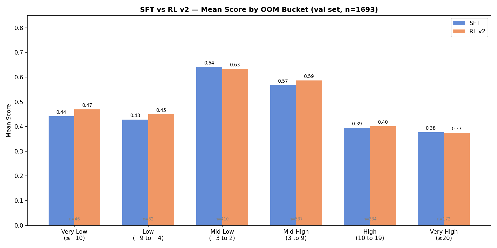
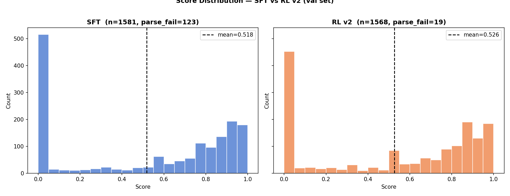
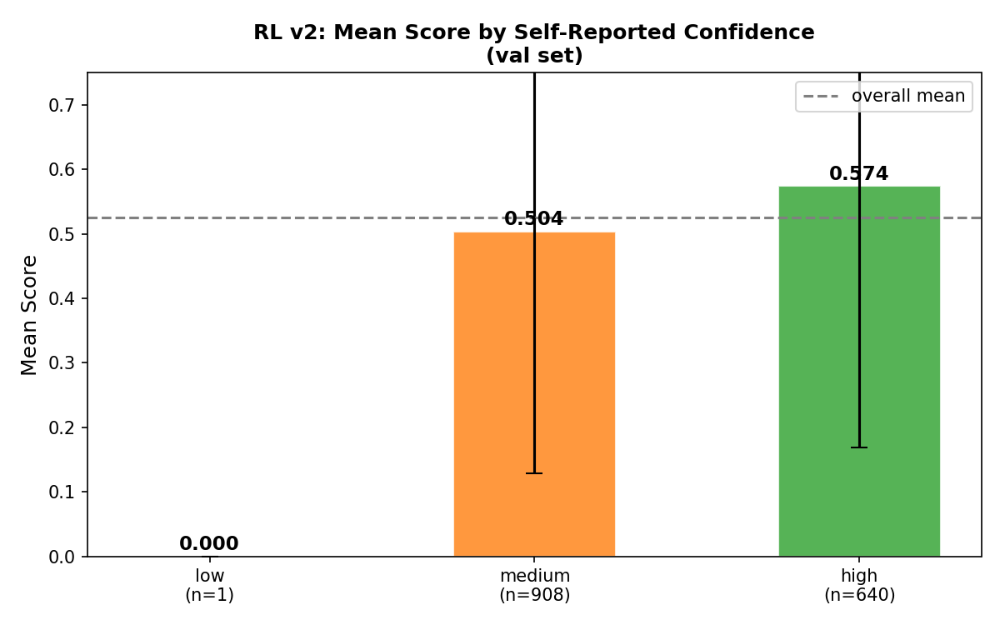

# Fermi Estimation Fine-Tuning — Analysis

## Pipeline Overview

```
Base Model (Qwen3-4B-Instruct-2507)
        ↓
   SFT (sft_filtered_v1_v2)
        ↓
   RL v2 (GRPO, 250 steps)
```

- **SFT checkpoint:** `tinker://3c5423d7-4ec3-5021-9e58-75b34401fe83:train:0/sampler_weights/final`
- **RL v2 checkpoint:** `tinker://441b50de-24c8-582e-bc7d-f1ca9a775a78:train:0/sampler_weights/final`
- **Val set:** `datasets/final/val.json` (1693 questions, never used in training)
- **Eval set:** `datasets/final/eval.json` (500 questions, held out for final reporting)

---

## SFT vs RL v2 — Val Set Performance

| Metric | SFT | RL v2 | Δ |
|--------|----:|------:|--:|
| N scored | 1581 | 1568 | — |
| Parse OK | 92.2% | 98.8% | **+6.6%** |
| Exact OOM | 31.8% | 31.5% | −0.3% |
| Within 1 decade | 57.1% | 55.7% | −1.4% |
| Within 2 decades | 65.7% | 68.1% | **+2.4%** |
| Mean score | 0.518 | 0.526 | **+0.008** |

**Key finding:** RL v2 primarily improved JSON formatting reliability (+6.6% parse_ok) and broad accuracy (within 2 decades). Exact OOM accuracy is roughly unchanged — RL is teaching the model to output valid structure and get in the right ballpark, but not to nail the exact exponent.

---

## Performance by OOM Bucket



| OOM Range | N | SFT Score | RL v2 Score | Δ |
|-----------|--:|----------:|------------:|--:|
| Very Low (≤−10) | 46 | — | 0.470 | — |
| Low (−9 to −4) | 82 | — | 0.449 | — |
| Mid-Low (−3 to 2) | 406 | — | 0.633 | — |
| Mid-High (3 to 9) | 534 | — | 0.586 | — |
| High (10 to 19) | 331 | — | 0.401 | — |
| Very High (≥20) | 169 | — | 0.374 | — |

**Key finding:** The model performs best on everyday-scale questions (−3 to 9). Performance degrades sharply at both extremes. Very High OOM (≥20) has a 48.5% zero-score rate — nearly half of all attempts fail completely.

---

## Error Rate by OOM


The error rate (fraction of questions scoring exactly 0) rises sharply outside the −3 to 9 range for both models. RL v2 reduces error rate in the everyday range but shows minimal improvement at extreme OOMs, where the zero-gradient problem in GRPO (all rollouts scoring 0 → no learning signal) limits improvement.

---

## Score Distribution



Both models show a bimodal distribution: a large spike at score=0 (complete failures) and a spread across 0.3–0.9 (partial to good answers). RL v2 shifts some mass from the 0 bin into the mid-range, consistent with the parse_ok improvement.

---

## Confidence Calibration



The model's self-reported confidence (`low`/`medium`/`high`) is **weakly correlated** with actual accuracy. High-confidence answers are wrong ~26% of the time. The model does not reliably know when it doesn't know — overconfidence is the dominant failure mode on tail OOM questions.

---

## RL Training Curves

| Run | Steps | Final Reward | Notes |
|-----|------:|-------------:|-------|
| RL v1 | 139 | 0.663 | Baseline GRPO run |
| RL v2 | 250 | 0.567 | Lower KL (0.02), improved reward fn |
| RL v3 | 78 (crashed) | 0.361 | Tail OOM oversampling without group_size increase caused reward decline |

**RL v3 lesson:** Oversampling tail OOM questions (50% vs natural 40%) without increasing `group_size` (kept at 4) caused more zero-gradient batches (`frac_all_bad` rose from 12.5% → 37.5%), driving reward down. The fix would be `group_size=8`.

---

## Reward Function (RL v2)

```
reward = 0.85 × oom_score + 0.15 × struct_score

oom_score    = max(0, 1 - delta / 1.5)   where delta = |log10(pred) - gold_oom|
struct_score = (has_factor + has_calc + has_formula) / 3

Tail OOM multiplier (gold_oom ≤ −4 or ≥ 10):
    oom_score = min(1.0, oom_score × 1.3)

Parse fail  → reward = −1.0
Schema fail → reward = −0.5
```

---

## Achuthan's Eval — SynthFP-Free Held-Out Set

Evaluated on `datasets/final/eval_no_synthfp.json` (320 rows — 180 synthetically-generated questions removed from the original 500-row eval set). Uses the same fp_score metric but run through `src/sampling/evaluate_sampling.py`.

| Metric | Baseline (no fine-tuning) | Finetuned (RL checkpoint) | Δ |
|--------|-------------------------:|-------------------------:|--:|
| N | 320 | 320 | — |
| Mean score | 0.516 | **0.574** | **+0.058** |
| Exact OOM accuracy | 31.8% | **38.8%** | **+7.0%** |
| Parse OK | 95.3% (305/320) | 99.4% (318/320) | **+4.1%** |
| Parse fail | 15 | 2 | −13 |

**Key finding:** On the synthFP-free eval set, the finetuned model shows a stronger improvement (+0.058 mean score, +7% exact OOM) than on the full val set (+0.008). This suggests the synthetic questions in the original dataset may have been inflating the baseline score — the model likely memorised patterns from synthFP questions during pretraining, masking how much the fine-tuning actually helped on real Fermi questions.

---

## Possible Future Plots

1. **SFT training loss curve** — requires wandb CSV export from sft_filtered_v1_v2 run
2. **RL reward curve across all runs** (v1/v2/v3) — requires wandb CSV exports
3. **Per-domain performance heatmap** — SFT vs RL v2 score by domain × OOM bucket
4. **Delta plot** — per-question score change (RL v2 − SFT), sorted by gold_oom
5. **Prediction scatter** — predicted OOM vs gold OOM, coloured by score
6. **Wrong-answer taxonomy** — breakdown of failures: sign error, magnitude error, unit error, knowledge gap

---

## Files

| File | Description |
|------|-------------|
| `run/sft_filtered_v1_v2_val.jsonl` | SFT inference on val set (1693 rows) |
| `run/rl_v2_val.jsonl` | RL v2 inference on val set (1693 rows) |
| `run/eval_nosynthfp_baseline.json` | Achuthan: baseline on synthfp-free eval (320 rows) |
| `run/eval_nosynthfp_finetuned.json` | Achuthan: finetuned on synthfp-free eval (320 rows) |
| `datasets/final/eval_no_synthfp.json` | Filtered eval set (synthFP questions removed) |
| `plots/sft_vs_rl_by_oom_bucket.png` | Bar chart: mean score by OOM bucket |
| `plots/error_rate_sft_vs_rl.png` | Line chart: error rate by OOM value |
| `plots/score_distribution.png` | Histogram: score distribution SFT vs RL v2 |
| `plots/confidence_calibration.png` | Bar chart: accuracy by self-reported confidence |
